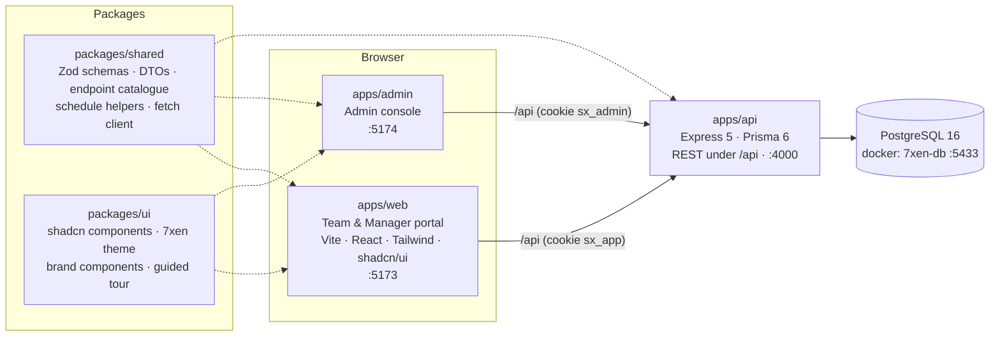

# 7xen

**Competitive Battlegrounds (PUBG / BGMI) scrim platform.** Managers publish scrims, teams register in
one tap, managers approve and slots are allotted automatically — no spreadsheets, no DM threads.

## What it does

**Phase 1 (current)**

- **Admin-issued logins.** The admin creates every manager and team account (no public sign-up yet),
  can edit, reset passwords and deactivate. Team names are unique regardless of case or spacing.
- **Scrim scheduling.** Managers create scrims with a map per match, a start time (IST) and a
  recurrence: **ONCE**, **DAILY** or **WEEKENDS** (Sat & Sun), with a slot count and first slot number
  (e.g. slots 3–18 when 1–2 are reserved).
- **Registration → approval → automatic slot allotment.** A team picks a date, sees the scrims
  running that day and registers. The manager approves from an inbox and the **lowest free slot** is
  allotted instantly — safe under concurrent approvals. Rejecting or cancelling frees the slot.
  Registration closes when the session starts.

**Phase 2 (planned)** — room id/password revealed to approved teams, match results ingested from
screenshot OCR (slot list → team mapping, final scoreboard → kills/placement → points table), and
leaderboards. See [docs/roadmap.md](docs/roadmap.md).

## Architecture



- One **contract package** (`packages/shared`) is imported by the API and both frontends: request
  schemas validate forms and API input; DTO types describe every response.
- The browser always calls `/api` **same-origin** (Vite proxy in dev, nginx in containers), so the
  httpOnly session cookie needs no CORS.
- Everything date-related runs in **IST**; dates travel as `YYYY-MM-DD` strings.

## Quick start

Prerequisites: **Node 24**, **pnpm 11** (`corepack enable`), **Docker** (for Postgres).

```bash
pnpm install
pnpm db:up                                  # Postgres 16 in docker (container 7xen-db, port 5433)
cp apps/api/.env.example apps/api/.env
pnpm db:migrate                             # apply Prisma migrations
pnpm db:seed                                # admin + demo managers, teams, scrims
pnpm dev                                    # api + web + admin in parallel
```

| App | URL |
| --- | --- |
| Web — teams & managers | http://localhost:5173 |
| Admin console | http://localhost:5174 |
| API | http://localhost:4000 (`/api/health`) |

Run `pnpm check` at any time to diagnose the local setup (toolchain, DB container, `.env`, migrations,
running services).

### Demo credentials (from the seed)

| Role | Username | Password | Sign in at |
| --- | --- | --- | --- |
| Admin | `admin` | `Admin@12345` | Admin console |
| Manager | `manager1`, `manager2` | `Manager@123` | Web |
| Team | `soul`, `godlike`, `blind`, `orangutan`, `global`, `revenant`, `xspark`, `medal` | `Team@1234` | Web |

The admin account comes from `ADMIN_USERNAME` / `ADMIN_PASSWORD` in `apps/api/.env`. Change all of
these outside local development.

## Scripts

| Command | What it does |
| --- | --- |
| `pnpm dev` | API, web and admin in watch mode |
| `pnpm dev:api` · `dev:web` · `dev:admin` | One app only |
| `pnpm build` | Build every package (API bundle via tsup, SPAs via Vite) |
| `pnpm typecheck` | `tsc --noEmit` across the workspace |
| `pnpm test` | Unit/API tests (Vitest) in every package that has them |
| `pnpm db:up` | Start the Postgres container (`docker-compose up -d db`) |
| `pnpm db:migrate` | `prisma migrate dev` (create/apply migrations) |
| `pnpm db:seed` | Seed admin + demo data |
| `pnpm db:studio` | Prisma Studio |
| `pnpm check` | Environment diagnostics (`scripts/dev-check.sh`) |
| `pnpm smoke` | End-to-end API smoke test of the whole phase-1 flow against a running API (`BASE_URL`, default `http://localhost:4000`) |
| `pnpm e2e` | Playwright browser smoke tests (`e2e/`; see below) |
| `pnpm stack:up` · `stack:down` · `stack:logs` | Production containers (`docker-compose --profile full`) |

### Smoke test

`pnpm smoke` (`scripts/smoke.ts`, plain Node 24 — no build step) drives the API like three browsers:
admin creates a manager and three teams (and checks duplicate team names → 409), the manager creates
a ONCE scrim for tomorrow with 2 slots starting at #3, the teams register, the manager approves
(slots 3, 4, then `SLOTS_FULL`), rejects, re-approves (slot 3 reused), a team cancels (slot 4 freed),
three simultaneous approvals race for 2 slots, cross-manager access is denied, and logout ends the
session. It prints ✓/✗ per step and exits non-zero on failure. Data uses random suffixes; at the end
the smoke scrims are archived and the smoke accounts deactivated.

```bash
pnpm smoke                                  # against pnpm dev
BASE_URL=http://localhost:8080 pnpm smoke   # against the docker stack, through nginx
```

### Browser tests

```bash
pnpm dlx playwright@1.62.1 install chromium   # one-time browser download
pnpm e2e                                      # against pnpm dev (5173 / 5174)
WEB_URL=http://localhost:8080 ADMIN_URL=http://localhost:8081 pnpm e2e   # against the stack
```

## Production containers

```bash
JWT_SECRET=$(openssl rand -hex 32) ADMIN_PASSWORD='…' pnpm stack:up
# web   → http://localhost:8080     admin → http://localhost:8081
pnpm db:seed                                # optional demo data (from the host; db is on :5433)
```

- `apps/api/Dockerfile` — multi-stage: pnpm via corepack, filtered install, `prisma generate`, tsup
  bundle, `pnpm deploy --prod`; the runtime runs `prisma migrate deploy` (retrying until Postgres is
  up) and then `node dist/index.js` as a non-root user.
- `apps/web/Dockerfile`, `apps/admin/Dockerfile` — Vite build served by nginx
  (`deploy/nginx/spa.conf.template`): `/api` proxied to the API, SPA fallback, immutable caching for
  hashed assets.
- The extra services live under the compose profile `full`, so `pnpm db:up` still starts only the
  database.

## Project structure

```
apps/
  api/            Express 5 + Prisma API          (src/, prisma/schema.prisma, prisma/seed.ts, Dockerfile)
  web/            Team & manager portal (Vite)    (src/, Dockerfile)
  admin/          Admin console (Vite)            (src/, Dockerfile)
packages/
  shared/         Contracts: api.ts, dto.ts, schemas.ts, enums.ts, schedule.ts, client.ts
  ui/             shadcn/ui components, theme, brand components, guided tour
deploy/           nginx config for the SPA images, API container entrypoint
docs/             domain.md · api.md · roadmap.md
e2e/              Playwright config + browser smoke specs
scripts/          smoke.ts (API e2e) · dev-check.sh
.github/workflows CI: install → prisma generate → typecheck → build → tests → seed → smoke; image builds
docker-compose.yml  db (default) + api/web/admin (profile "full")
```

## Conventions

- **Contracts first.** Endpoints, inputs and responses are defined in `packages/shared`
  (`api.ts`, `schemas.ts`, `dto.ts`); API and frontends both import them. Change them only
  backward-compatibly.
- **Errors** are always `{ "error": { "code", "message", "fields?" } }` with short, user-facing
  messages; `fields` maps form fields to messages. See [docs/api.md](docs/api.md#errors).
- **Auth**: httpOnly JWT session cookies — `sx_app` (managers, teams) and `sx_admin` (admin) never mix.
  Managers only ever see their own scrims; other managers' ids return 404.
- **Time**: IST everywhere; dates are `YYYY-MM-DD` strings, times `HH:mm`; use the helpers in
  `@7xen/shared` (`todayInAppTz`, `addDays`, `occursOn`, …).
- **Frontend**: shadcn/ui from `@7xen/ui`, theme tokens only (light and dark), TanStack Query for data,
  react-hook-form + the shared Zod schema for forms, a guided tour on every page.
- TypeScript strict everywhere; pnpm workspaces; Node 24.

## Documentation

- [docs/domain.md](docs/domain.md) — roles, scrim lifecycle, registration state machine, slot
  allotment and its concurrency guarantee, timezone rules
- [docs/api.md](docs/api.md) — endpoint reference with examples and error codes
- [docs/roadmap.md](docs/roadmap.md) — phase 2 and beyond
