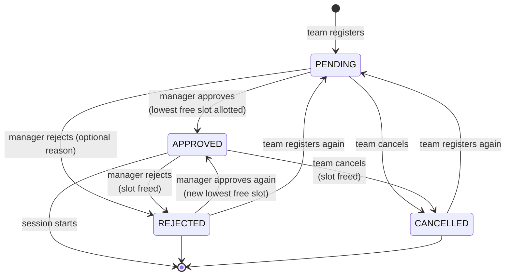

# Domain model — phase 1

This document describes how 7xen works as a product: who uses it, what a scrim is, and the rules
the API enforces. The API (`apps/api`) is the source of truth; the endpoint contracts live in
[`packages/shared/src/api.ts`](../packages/shared/src/api.ts) and are documented in [api.md](./api.md).

## Roles

| Role | Who | How the login is created | Where they sign in |
| --- | --- | --- | --- |
| **ADMIN** | Platform owner | Seeded from `ADMIN_USERNAME` / `ADMIN_PASSWORD` in `apps/api/.env` | Admin console (`apps/admin`, :5174) |
| **MANAGER** | Scrim organiser / host | Created by the admin | Web portal (`apps/web`, :5173) |
| **TEAM** | A squad (one shared login per team) | Created by the admin directly, **or** requested by a manager and approved by the admin | Web portal (`apps/web`, :5173) |

- There is **no self sign-up in phase 1**. The admin issues every manager login and can edit
  profiles, reset passwords and deactivate accounts.
- **Managers can register teams.** A manager's team is stored as a `TeamRequest` (PENDING) — no
  login exists yet. Trying to sign in with those details says "waiting for admin approval".
  The admin approves (the `User` + `Team` are created atomically; double-approve → 409) or rejects
  with an optional reason (the manager sees it, and the name/username become free again). A manager
  can withdraw a request while it is PENDING.
- Deactivating an account takes effect immediately: the session user is re-read on every request, so
  an existing session stops working on the next call.
- Admin and app sessions use **separate httpOnly cookies** (`sx_admin`, `sx_app`), so being signed
  in to the admin console never grants access to the manager/team API and vice versa.
- **Team names are unique**, ignoring case and repeated spaces: `Team Soul`, `team soul` and
  `  TEAM   SOUL ` collide. This is enforced by a unique `nameKey` column
  (`teamNameKey()` = trim → collapse whitespace → lowercase). Usernames are stored lowercase and
  are unique across all roles. Uniqueness also covers **pending team requests** (partial unique
  indexes on `TeamRequest(nameKey|username) WHERE status = 'PENDING'`), so a name can't be queued
  twice or created by the admin while a manager's request for it is waiting. Both portals show a
  live "Available / Already taken" check while typing.

## Scrims and sessions

A **scrim** is a recurring (or one-off) custom-room event a manager runs:

| Field | Meaning |
| --- | --- |
| `title`, `description` | Shown to teams |
| `maps` | One entry per match, in play order (e.g. `["ERANGEL","MIRAMAR","SANHOK"]` = 3 matches) |
| `startTime` | `"HH:mm"` (24h) **in IST** |
| `recurrence` | `ONCE` — only on `startDate` · `DAILY` — every day · `WEEKENDS` — Saturdays and Sundays |
| `startDate` / `endDate` | `YYYY-MM-DD`. `endDate` is ignored for `ONCE`; `null` = runs indefinitely |
| `slotCount` | How many team slots the room offers (min 2) |
| `firstSlot` | First slot number handed to teams. Organisers often reserve slots 1–2 for observers/hosts, so `firstSlot: 3, slotCount: 16` gives slots **3…18**. `firstSlot + slotCount − 1 ≤ 25` (max squads in a room) |
| `status` | `ACTIVE` — listed to teams, takes registrations · `PAUSED` — hidden from teams, closed to registrations · `ARCHIVED` — retired (still in the manager's list, sorted last) |

A scrim **occurs** on a date when `occursOn()` (in `packages/shared/src/schedule.ts`) says so:

```
date < startDate                        → no
ONCE                                    → date == startDate
endDate set and date > endDate          → no
DAILY                                   → yes
WEEKENDS                                → date is Saturday or Sunday
```

One occurrence is a **session** — a `ScrimSession` row keyed by `(scrimId, date)`. Session rows are
created lazily on the first registration, so a daily scrim does not pre-create rows for every
future day. Phase 2 attaches room details and match results to the session.

## Scrim lifecycle (day to day)

```mermaid
sequenceDiagram
  autonumber
  participant A as Admin
  participant M as Manager
  participant T as Team
  participant API as 7xen API
  A->>API: Create manager + team logins
  M->>API: Create scrim (maps, time, recurrence, slots)
  T->>API: Pick a date → list scrims running that day
  T->>API: Register for a scrim on that date
  API-->>T: PENDING ("Waiting for manager approval")
  M->>API: Open approvals inbox, approve
  API-->>M: APPROVED, lowest free slot allotted (e.g. #3)
  T->>API: Sees "Approved — Slot #3"
  Note over M,T: Until the session starts: the manager may reject (frees the slot),<br/>the team may cancel (frees the slot)
  Note over API: At startsAt registration closes; phase 2 reveals room id/password to approved teams
```

## Registration state machine



Rules:

- **One registration row per team per session** (`@@unique([sessionId, teamId])`). Registering again
  after a rejection or cancellation reuses the row and resets it to `PENDING`. Registering while
  `PENDING` or `APPROVED` → `409 CONFLICT`.
- `slotNumber` is set **only while `APPROVED`**; reject and cancel clear it.
- Approving an already approved registration is a no-op (returns it unchanged). Approving or
  rejecting a `CANCELLED` registration → `409 CONFLICT`.
- **Registration closes at the session start time** (`startsAt` = date + `startTime` in IST). After
  that, registering and cancelling return `409 REGISTRATION_CLOSED`. Registering for a `PAUSED`
  scrim also returns `REGISTRATION_CLOSED`; registering for a date the scrim does not run on returns
  `404 NOT_FOUND`.
- Teams see `ACTIVE` scrims of **all active managers**. Managers see and act on **only their own**
  scrims and registrations — anything else returns `404 NOT_FOUND`, so ids of other managers'
  resources are not even confirmed to exist.

## Slot allotment

When a manager approves a registration, the API allots the **lowest free slot** in
`firstSlot … firstSlot + slotCount − 1`:

```
taken  = slot numbers of APPROVED registrations in this session
slot   = first n in slotRange(firstSlot, slotCount) with n ∉ taken
none   → 409 SLOTS_FULL ("All slots are taken. Reject a team or add more slots.")
```

Because reject/cancel free a slot, gaps are refilled first: with slots 3–4 full, rejecting the team on
#3 and approving another team gives the new team **#3**, not #5.

### Concurrency guarantee

Two managers' tabs (or a double click) can approve at the same instant. The approval runs in a
single database transaction that first takes a **row lock on the session**
(`SELECT … FROM "ScrimSession" WHERE id = $1 FOR UPDATE`), then reads the taken slots and writes the
new one. Approvals for the same session are therefore serialised; approvals for different sessions
run in parallel. As a last line of defence, `@@unique([sessionId, slotNumber])` makes a duplicate slot
impossible at the database level (Postgres treats `NULL`s as distinct, so unallotted rows don't
collide); a violation surfaces as `409 CONFLICT` ("That slot was just taken. Please try again.").

The smoke test (`pnpm smoke`) verifies this by firing three simultaneous approvals at a 2-slot
session and expecting exactly slots 1 and 2 plus one `SLOTS_FULL`.

## Time and dates

- The platform runs in **one timezone: IST (`Asia/Kolkata`, UTC+05:30)**. Players and hosts are in
  India; a scrim at "21:00" means 21:00 IST for everyone, regardless of the browser's timezone.
- **Dates travel as `YYYY-MM-DD` strings** and times as `"HH:mm"` strings — never as JS `Date`
  objects — so nothing shifts across timezones. Use the helpers from `@7xen/shared`:
  `todayInAppTz()`, `addDays()`, `weekdayOf()`, `occursOn()`, `sessionStartsAt()`.
- Instants (`startsAt`, `createdAt`, `decidedAt`, `lastLoginAt`) are ISO-8601 UTC timestamps, e.g.
  a 18:00 IST session on 2026-10-17 has `startsAt: "2026-10-17T12:30:00.000Z"`.
- In Postgres, scrim and session dates are `DATE` columns; times-of-day are plain strings.
- "Today", "upcoming" and "past" are computed in IST on the server.
