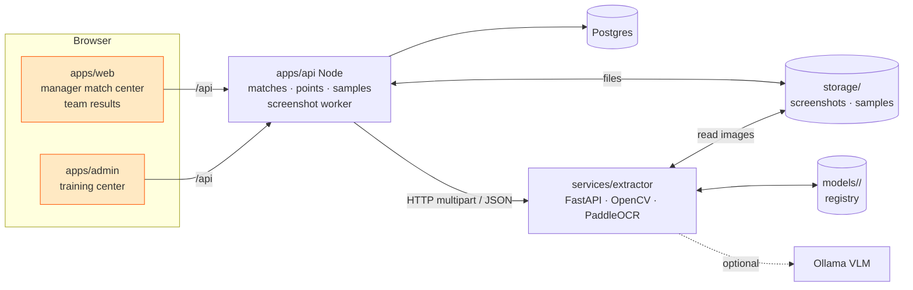

# Phase 2 — Match results from screenshots

Managers upload in-game screenshots; 7xen reads slots, player names, placements and finishes,
the manager checks/fixes them, publishes, and the points table updates for everyone. Every
confirmed screenshot becomes labelled training data; the admin retrains the reader from the
current model ("train the old trainer model with the new set"), compares metrics, and promotes.

## Real input (see `services/extractor/eval/dataset/real/`, labels in `labels.json`)

| Screenshot | What it shows | Notes |
|---|---|---|
| **SLOT_LIST** (`lobby-*.jpg`) | 3×3 grid of dark cards: coloured slot number (05, 06 …) + up to 4 player names + "/0 Eliminations" | 25 slots → 3 screenshots; empty slots skipped (no slot 10); teams of 3 exist (slot 20); names contain `多 シ 《》 £ · Ā Ø Û`, Devanagari, upside-down Latin, `I/l/1`, `O/0` |
| **RESULTS** (`result-*.jpg`) | Left panel pinned: rank 1 (wings icon, no digit!) and rank 2. Right panel scrolls: 3 rank blocks per screenshot, each = big rank number + up to 4 names + "N finishes"/"1 finish" | **No slot numbers** — slot comes from matching names to the confirmed lineup. Ranks 1–2 repeat in every screenshot → dedupe by rank. Top/bottom rows may be cut off → drop partial blocks |

All samples are 1600×720 (20:9). Layout ratios live in `services/extractor/app/config/layout.yaml`.

## Components

* **apps/api** owns all business data. A background worker (in-process, polls `Screenshot` rows
  `QUEUED` with `FOR UPDATE SKIP LOCKED`, max 2 concurrent) sends each image to the extractor with
  the session roster, stores the `ExtractionResult`, and merges it into the match draft. If the
  extractor is down: screenshot → `FAILED` "Screenshot reader is offline — enter results by hand or
  retry", nothing else breaks.
* **services/extractor** is stateless for extraction; it owns model versions and training runs on
  disk (`MODELS_DIR`). Images for training/eval are read from the shared `STORAGE_DIR`.
* Env: API `STORAGE_DIR` (default `<repo>/storage`), `EXTRACTOR_URL` (default `http://localhost:8090`);
  extractor `STORAGE_DIR` (same dir), `MODELS_DIR` (default `services/extractor/models`), `VLM_ENABLED=false`.

## Extraction pipeline (services/extractor)

1. **detect** — SLOT_LIST: threshold dark card panels → contours → 9 boxes, row-major; fallback to the
   % grid in layout.yaml. RESULTS: left panel (rank 1–2 blocks) + right panel; split right panel into
   blocks by the dark separators / big rank digit positions; drop blocks cut by the panel edge.
2. **crop** — per card/block: slot/rank region, name strips (4), finishes strips (results).
3. **preprocess** — names: 3× INTER_CUBIC, grayscale, keep bright text, invert, pad. Slot digits: HSV
   (coloured). Results on gold background: separate threshold profile (dark-on-gold vs white).
4. **OCR** — PaddleOCR recognition-only per strip (PP-OCRv5 multilingual), digits-only paths for
   slot/rank/finishes. Rank 1 has no digit → detect the wings icon / "first block in left panel" = 1.
5. **postprocess** — NFC, strip edge noise, evidence-backed lookalike fixes (from the model bundle),
   "N finishes" → int, validation.
6. **roster match** — when a roster (slot → names) is sent: rapidfuzz per name; `matched_slot` per
   player; results rows get `inferred_slot` by majority. Also the bundle `lexicon` (all names ever
   confirmed) snaps near-misses.
7. **VLM fallback** (off by default; the dev GPU has 2 GB) — Ollama Qwen-VL on low-confidence strips.

## Data model (apps/api/prisma/schema.prisma)

`Scrim.pointsSystem` · `Match` (per map, per session) · `Screenshot` · `MatchTeam` (slot, team, placement,
kills, points) · `MatchPlayer` (position, name, ocrName, kills) · `TeamPlayer` (roster) · `TrainingSample`.
Contract: `packages/shared/src/phase2.ts` (endpoints in its header), points rules in `points.ts`.

### Merging extraction into a match

* SLOT_LIST → for each extracted team with a slot: upsert `MatchTeam(slot)` (teamId = approved
  registration on that slot), players by position (`name` = rosterMatch ?? OCR text, `ocrName`, `ocrConfidence`).
  Never overwrite rows the manager already confirmed (status ≥ LIVE) — add a warning instead.
* RESULTS → each row: slot = `inferredSlot` (players matched against the lineup); set placement = rank,
  player kills by name match, team kills = sum. Rows that can't be mapped → warning listing the names.
  Duplicate ranks across screenshots (1 and 2 every time) are merged, not double counted.
* Flags shown to the reviewer: slot without registered team, registered team missing, duplicate
  placement, kills ≠ sum of player kills, low-confidence names (< 0.85), team size ≠ 4.

### Points

`computeStandings()` in shared — placement table + kill points, tie-breakers total → wins → placement
points → kills → last match placement. Stored per MatchTeam on publish; standings computed on read.

## Training loop ("admin trains the model")

1. **Samples**: every lineup confirmation/publish creates `TrainingSample(source=MANAGER_CORRECTION,
   verified=true)` per screenshot with labels = confirmed values (SLOT_LIST: teams on that screenshot;
   RESULTS: ranks on that screenshot). Admin can upload screenshots + labels (pre-filled by the current
   model, then corrected in a label editor). Split TRAIN/TEST 70/30 by sha256 (stable), admin can change.
   The 7 real screenshots are seeded as `source=SEED, verified=false` until the admin confirms them.
2. **Run**: admin starts a run → API sends verified, non-excluded samples to `POST /v1/training/runs`
   with `base_version` = active. The trainer **starts from the base version's artifacts** and produces
   version N+1 (`parent` = base):
   * `adaptive` trainer (always available, CPU, seconds–minutes): lexicon = base lexicon ∪ label names;
     char_fixes learned from the confusion report on TRAIN; layout ratios/thresholds grid-searched on TRAIN.
   * `paddle_finetune` trainer (when training deps + enough samples, ≥ 200 name crops): fine-tunes the
     recognition model **initialised from the base version's rec model** on name-strip crops cut with the
     labels. Slow on CPU; runs in a subprocess with progress + log tail.
3. **Evaluate**: metrics on the TEST split for base and new version (`eval/run_eval.py` logic).
4. **Promote**: admin activates the new version (or auto-activate if test name accuracy improved).
   Rollback = activate an older version. Never claim accuracy that run_eval didn't measure.

## Ownership for parallel work

| Workstream | Owns |
|---|---|
| Extractor · pipeline | `services/extractor/app/{api/extract.py,pipeline/**,config/**,settings.py,logging.py}`, `tests/test_pipeline*`, Dockerfile, extractor service in docker-compose |
| Extractor · ML | `services/extractor/{app/training/**,app/api/training.py,eval/**,synth/**}`, `tests/test_training*`, `tests/test_eval*` |
| API | `apps/api/**` |
| Web | `apps/web/src/**` (manager match center, team results/roster) |
| Admin | `apps/admin/src/**` (training center, model versions, extractor status) |
