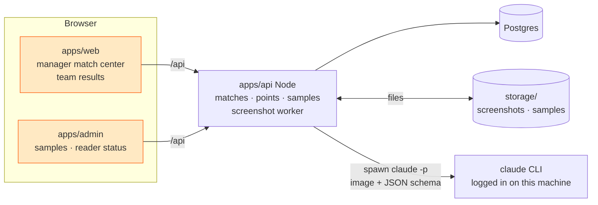

# Phase 2 — Match results from screenshots

Managers upload in-game screenshots; 7xen reads slots, player names, placements and finishes,
the manager checks/fixes them, publishes, and the points table updates for everyone. Every
confirmed screenshot becomes labelled training data; the admin retrains the reader from the
current model ("train the old trainer model with the new set"), compares metrics, and promotes.

## Real input (see `datasets/bgmi-screenshots/real/`, labels in `labels.json`)

| Screenshot | What it shows | Notes |
|---|---|---|
| **SLOT_LIST** (`lobby-*.jpg`) | 3×3 grid of dark cards: coloured slot number (05, 06 …) + up to 4 player names + "/0 Eliminations" | 25 slots → 3 screenshots; empty slots skipped (no slot 10); teams of 3 exist (slot 20); names contain `多 シ 《》 £ · Ā Ø Û`, Devanagari, upside-down Latin, `I/l/1`, `O/0` |
| **RESULTS** (`result-*.jpg`) | Left panel pinned: rank 1 (wings icon, no digit!) and rank 2. Right panel scrolls: 3 rank blocks per screenshot, each = big rank number + up to 4 names + "N finishes"/"1 finish" | **No slot numbers** — slot comes from matching names to the confirmed lineup. Ranks 1–2 repeat in every screenshot → dedupe by rank. Top/bottom rows may be cut off → drop partial blocks |

All samples are 1600×720 (20:9).

## Components

* **apps/api** owns all business data. A background worker (in-process, polls `Screenshot` rows
  `QUEUED` with `FOR UPDATE SKIP LOCKED`, max 2 concurrent) reads each image with the session roster,
  stores the `ExtractionResult`, and merges it into the match draft. If the reader can't run (CLI missing
  or not logged in): screenshot → `FAILED` "Screenshot reader is offline — enter results by hand or
  retry", nothing else breaks.
* **The reader** (`apps/api/src/lib/extractor.ts`) runs `claude -p --input-format stream-json` with the
  image as a base64 content block, a fixed system prompt, `--json-schema` per screenshot kind, no tools,
  in an empty temp dir. It uses whatever login `claude` has on the machine (run `claude` once to log in).
  ~20–30 s per screenshot.
* Env: API `STORAGE_DIR` (default `<repo>/storage`), `CLAUDE_BIN` (default `~/.local/bin/claude`, else
  `claude` on PATH), `CLAUDE_MODEL` (default `sonnet`). The Docker `full` profile has no CLI in the API image,
  so screenshots show "reader offline" there — run the API on the host.
* The old Python/PaddleOCR service (`services/extractor`) was removed on 2026-10-18; a copy lives outside
  the repo in `~/7xen-backups/extractor-2026-10-18`.

## Reading (apps/api/src/lib/extractor.ts)

1. **Prompt** — SLOT_LIST: every visible card → slot + names in order. RESULTS: every fully visible rank
   block (rank 1 = wings icon, no digit) → rank + names + finishes. Names copied character for character;
   ambiguous glyphs → `unsure: true`; cut-off blocks skipped; warnings only for real problems.
2. **Roster** — when a roster (slot → names) is sent, Claude returns `roster_match` per name; the API keeps
   it only if it is an exact roster name, sets `matched_slot`, and RESULTS rows get `inferred_slot` by majority.
3. **Mapping** — confidence 0.97 (sure) / 0.6 (unsure, so the review screen flags it); `needsReview` when any
   name is unsure, unmatched against a given roster, or there are warnings; duplicate ranks dropped.

Measured on the 7 real screenshots (2026-10-18, sonnet): slots 17/17, kills 99/99, results rows → right slot
25/25, names exact 142/166 (misses are lookalike glyphs: Û/U, g/q, I/1/l; several labels themselves are flagged
`needs_human_check`).

## Data model (apps/api/prisma/schema.prisma)

`Scrim.pointsSystem` · `Match` (per map, per session) · `Screenshot` · `MatchTeam` (slot, team, placement,
kills, points) · `MatchPlayer` (position, name, ocrName, kills) · `TeamPlayer` (roster) · `TrainingSample`.
Contract: `packages/shared/src/phase2.ts` (endpoints in its header), points rules in `points.ts`.

### Merging extraction into a match

* SLOT_LIST → for each extracted team with a slot: upsert `MatchTeam(slot)` (teamId = approved
  registration on that slot), players by position (`name` = rosterMatch ?? OCR text, `ocrName`, `ocrConfidence`).
  Never overwrite rows the manager already confirmed (status ≥ LIVE) — add a warning instead.
* RESULTS → each row: slot = `inferredSlot` (players matched against the lineup); set placement = rank,
  player kills by name match, team kills = sum. Rows that can't be mapped → warning listing the names.
  Duplicate ranks across screenshots (1 and 2 every time) are merged, not double counted.
* Flags shown to the reviewer: slot without registered team, registered team missing, duplicate
  placement, kills ≠ sum of player kills, low-confidence names (< 0.85), team size ≠ 4.

### Points

`computeStandings()` in shared — placement table + kill points, tie-breakers total → wins → placement
points → kills → last match placement. Stored per MatchTeam on publish; standings computed on read.

## Labelled samples

Every lineup confirmation/publish still creates `TrainingSample(source=MANAGER_CORRECTION, verified=true)`
per screenshot; admins can upload screenshots + labels (pre-filled by the reader, corrected in the label editor).
There is no model to train any more — samples are a labelled test set for checking the reader (e.g. after
changing the prompt or `CLAUDE_MODEL`).

## Ownership for parallel work

| Workstream | Owns |
|---|---|
| Reader | `apps/api/src/lib/extractor.ts`, `apps/api/tests/merge.test.ts` (mapping) |
| API | `apps/api/**` |
| Web | `apps/web/src/**` (manager match center, team results/roster) |
| Admin | `apps/admin/src/**` (samples, reader status) |
