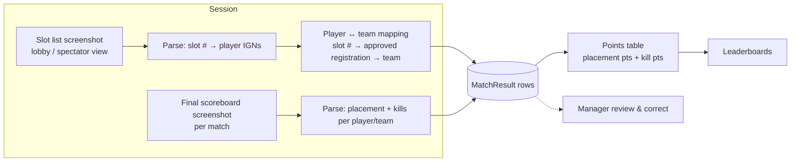

# Roadmap

Phase 1 (shipping now) covers accounts, scrim scheduling, registration, approval and slot allotment —
see [domain.md](./domain.md). Phase 2 turns 7xen from a booking tool into the place where a scrim is
actually run and scored. The phase 1 schema was shaped for this: **`ScrimSession` is the anchor**
that room details, results and screenshots hang off.

## Phase 2

### 1. Room details reveal

Today teams coordinate room id/password over WhatsApp/Discord. Instead:

- New `ScrimSession` fields (or a `SessionRoom` table if per-match rooms are needed): `roomId`,
  `roomPassword`, `revealAt` (default: `startsAt − 15 min`), `updatedAt`.
- Manager enters room details on the session page; can edit until the session ends.
- **Only APPROVED teams** of that session see them, and only after `revealAt` — the API omits the
  fields otherwise (never hide them only in the UI).
- Team dashboard "Next match" card shows a countdown, then room id/password with copy buttons and the
  team's slot number.
- Audit: store who changed the room details and when.

### 2. Match result ingestion from screenshots

Hosts already have a screenshot-reading (OCR) system. 7xen integrates with it instead of
re-implementing OCR:

- **Slot list screenshot → player/team mapping.** Slot numbers are already authoritative in 7xen
  (APPROVED registration ↔ `slotNumber`), so slot list parsing maps in-game player names to a team
  via the slot. Store `PlayerAlias(teamId, ign, firstSeenAt)` so later matches resolve names even if
  slot reading fails.
- **Final scoreboard → kills and placement.** One `Match` per entry in `scrim.maps` (index = match
  number, map = scrim.maps[i]); `MatchResult(matchId, teamId, placement, kills, source, confidence)`.
- **Points table.** Configurable per scrim (`PointsSystem`: placement → points, points per kill;
  default to the common BGMI esports table, e.g. 1st 10 · 2nd 6 · 3rd 5 · 4th 4 · 5th 3 · 6th 2 ·
  7th–8th 1 · 1 pt per finish). Session standings = sum over matches; tie-breakers: total placement
  points, then kills, then best single-match placement.
- **Human in the loop.** OCR output lands as a *draft*; the manager reviews (low-confidence cells
  highlighted), corrects and publishes. Keep the original screenshots (object storage, e.g. S3/R2)
  linked to the session for disputes.
- **Integration shape.** The OCR system calls an authenticated ingestion endpoint
  (`POST /api/manager/sessions/:id/screenshots` → job id) or 7xen calls it; processing is async with a
  job table (`pending → parsed → reviewed → published`) so uploads never block a request.

### 3. Leaderboards

- Per session (published results), per scrim series (e.g. weekly / monthly for a DAILY scrim), and
  global team rankings.
- Team profile page: history, average placement, kills, wins.
- Materialise standings on publish (a `Standing` table or Postgres materialised view) rather than
  computing on every read.

### 4. Team self-signup with email verification

- Public signup: team name (same `nameKey` uniqueness), tag, captain, email, password.
- Email verification token (hashed, expiring) before the account can register for scrims; optional
  admin approval toggle for curated communities.
- Password reset by email (replacing admin-only resets for teams).
- Requires a transactional email provider (SES / Postmark / Resend) and rate-limited, captcha-protected
  signup.

### 5. Notifications

- Events: registration approved/rejected (with slot), room details revealed, session starting soon,
  results published; for managers: new registration, team cancelled.
- In-app notification centre first (a `Notification` table + polling or SSE), then email, then
  push / WhatsApp / Discord webhooks per manager.
- Delivered from an outbox table processed by a worker so a failed send never rolls back the action
  that caused it.

### 6. Search

The admin and team lists will grow. Plan:

1. **Now:** `ILIKE` on indexed columns (current implementation) — fine for thousands of rows.
2. **Next:** Postgres `pg_trgm` GIN indexes on `Team.name`, `Team.tag`, `User.username`,
   `Scrim.title` for fast fuzzy / typo-tolerant search ("soull" → "Team Soul"), plus
   `tsvector` full-text search on scrim titles/descriptions.
3. **Only if** search becomes a product in itself (cross-entity ranking, facets, very high volume) —
   consider Elasticsearch/OpenSearch. Until then, Postgres keeps one datastore, transactional
   consistency and zero sync jobs.

## Platform / ops backlog

- Per-match room support (different room per map) if hosts need it.
- Manager-side "add more slots" from the SLOTS_FULL state.
- Bulk team import (CSV) for admins.
- Observability: structured logs are already JSON in production (pino) — ship to a log store; add
  request metrics and an uptime check on `/api/health`.
- Backups: nightly `pg_dump` of the Postgres volume, tested restores.
- Image hardening: distroless/slim runtime, non-root (already), read-only root FS.
